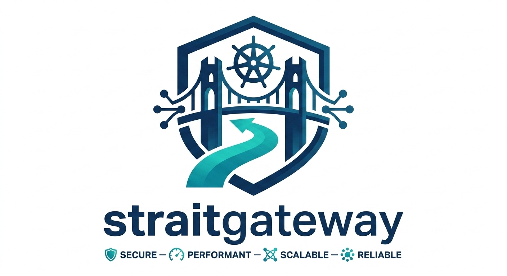

<p align="center">
  
</p>

# StraitGateway

[](https://github.com/straitgateway/straitgateway/actions/workflows/ci.yml)
[](LICENSE)
[](https://goreportcard.com/report/github.com/straitgateway/straitgateway)

StraitGateway is a Kubernetes-native transit gateway, CNI, sidecarless service mesh, and networking platform designed to provide high-performance connectivity between pods, nodes, services, Kubernetes clusters, and external networks.

It leverages **eBPF**, **netkit**, **WireGuard**, **BGP**, and **BFD** to provide programmable packet processing, secure connectivity, dynamic routing, service load balancing, and network observability.

---

## Core Architecture

```
                            ┌──────────────────────────────┐
                            │          Kubernetes          │
                            │   API Server / Gateway API   │
                            └──────────────┬───────────────┘
                                           │
                                           ▼
                  ┌─────────────────────────────────────────────┐
                  │         StraitGateway Control Plane         │
                  │  ┌────────────────┐   ┌──────────────────┐  │
                  │  │ SG Controller  │   │ Gateway / CNI    │  │
                  │  │                │   │ Controller       │  │
                  │  └───────┬────────┘   └────────┬─────────┘  │
                  └──────────┼─────────────────────┼────────────┘
                             │                     │
                             ▼                     ▼
      ┌──────────────────────────────────────────────────────────────┐
      │                       Kubernetes Nodes                       │
      │  ┌────────────────────────────────────────────────────────┐  │
      │  │                  StraitGateway Agent                   │  │
      │  │                       (straitd)                        │  │
      │  │  ┌──────────────┐     ┌────────────────────────────┐   │  │
      │  │  │ CNI Manager  │────▶│     eBPF Dataplane         │   │  │
      │  │  └──────────────┘     │  eBPF + CO-RE              │   │  │
      │  │                       │  netkit                    │   │  │
      │  │                       │  Service / LB / Routing    │   │  │
      │  │                       └─────────────┬──────────────┘   │  │
      │  │       ┌─────────────────────────────┴─────────────┐    │  │
      │  │  ┌────▼───────┐                            ┌──────▼──┐ │  │
      │  │  │ WireGuard  │                            │ BGP/BFD │ │  │
      │  │  │ Tunnel     │                            │ Routing │ │  │
      │  │  └────┬───────┘                            └──────┬──┘ │  │
      │  └───────┼───────────────────────────────────────────┼────┘  │
      └──────────┼───────────────────────────────────────────┼───────┘
                 │                                           │
                 ▼                                           ▼
           ┌───────────┐                              ┌─────────────┐
           │ Other SG  │                              │ External    │
           │ Nodes     │                              │ Routers /   │
           │           │                              │ Networks    │
           └───────────┘                              └─────────────┘
```

---

## Core Technology Stack

| Layer | Technology | Purpose |
|---|---|---|
| **Language** | **Go 1.27.1** | Controllers, agents, networking services, and CLI |
| **Kernel** | **Linux 6.8+ (6.12+ LTS Recommended)** | Host networking, TCX, netkit, and eBPF dataplane |
| **Dataplane** | **eBPF CO-RE** (`cilium/ebpf`) | Programmable, high-performance packet processing across kernels |
| **Pod Networking** | **netkit** | Next-generation direct pod-to-kernel packet handoff |
| **Security & Tunnels** | **WireGuard** | High-speed encrypted inter-node and inter-cluster overlay |
| **Dynamic Routing** | **BGP** | Dynamic route exchange with external networks & top-of-rack switches |
| **Failure Detection**| **BFD** | Sub-second detection of routing peer failures |
| **Orchestration** | **Kubernetes Gateway API v1.6.1** | Native declarative traffic management and transit gateway routing |
| **Observability** | **Prometheus + OTel + Loki** | eBPF ring buffer telemetry, metrics, traces, and flow logs |
| **Web UI** | **React 19 + TypeScript + D3.js** | Live cluster topology & observability without third-party query bloat |

---

## Implementation Roadmap

| Phase | Milestone | Focus Areas | Status |
|---|---|---|:---:|
| **Phase 1** | **Dataplane Foundation & BPF Maps** | 13 maps, loader, pins, TCX/XDP/cgroups, per-CPU counters | **Done** |
| **Phase 2** | **Native CNI & IPAM Subsystem** | `netkit` L3/L2 driver, IPAM bitmap allocator, `sg-cni` binary | **Done** |
| **Phase 3** | **Service Networking & Maglev** | Maglev lookup table, connect4/6 in-socket LB, TC NAT | **Done** |
| **Phase 4** | **Transit Gateway & Routing** | FIB LPM engine, VRF routing, WireGuard mesh, BGP, sub-50ms BFD | **Done** |
| **Phase 5** | **Security Policies & Mesh** | Workload identity engine, policy compiler, NodeProxy L7 engine | **Done** |
| **Phase 6** | **Dataplane Observability** | Prometheus exporter, flow log ring buffer, HTTP status server | **Done** |
| **Phase 7** | **CLI, Helm & Manifests** | `sgctl` CLI (11 subcommands), Helm chart v1.0.0, `all-in-one.yaml` | **Done** |
| **Phase 8** | **UI Plane & Integration** | React 19, Tailwind CSS 4, D3.js topology, REST API bridge | **Done** |
| **Phase 9** | **Multi-Cluster Transit (ClusterMesh)** | Global WireGuard mesh, cross-cluster Maglev, Split-DNS | **Done** |
| **Phase 10** | **Advanced L7 & Hardware Acceleration** | SmartNIC `XDP_OFFLOAD`, Wasm extension engine, Gateway API v1.6.1 | **Done** |
| **Phase 11** | **Enterprise Zero-Trust & In-Kernel mTLS** | SPIFFE/SPIRE attestation, kTLS + `sockops` zero-copy encryption | **Done** |
| **Phase 12** | **Chaos Engineering & eBPF Fuzzing** | Sonobuoy CNI conformance, BPF map fault injection, multi-kernel CI | *Planned* |
| **Phase 13** | **AI/ML & RDMA/RoCEv2 Acceleration** | GPU/TPU RoCEv2 bypass, NCCL optimization, PFC/ECN telemetry | *Planned* |
| **Phase 14** | **Autonomous Dataplane AIOps** | Micro-burst detection, self-healing routing, zero-code tracing | *Planned* |
| **Phase 15** | **Documentation System (`docs/`)** | Markdown technical specs, guides, CRD & dataplane manuals (`*.md`) | **Done** |

---

## Building StraitGateway

```bash
# Clone the repository
git clone https://github.com/straitgateway/straitgateway.git
cd straitgateway

# Build all binaries
make build

# Output binaries will be in ./bin/:
#   ./bin/straitd         (Node Daemon)
#   ./bin/sg-controller   (Cluster Controller)
#   ./bin/sg-cni          (CNI Plugin)
#   ./bin/sg-agent        (Node Agent)
#   ./bin/sgctl           (Diagnostic CLI)
```

---

## License

StraitGateway is licensed under the Apache 2.0 License. See [LICENSE](LICENSE) for details.