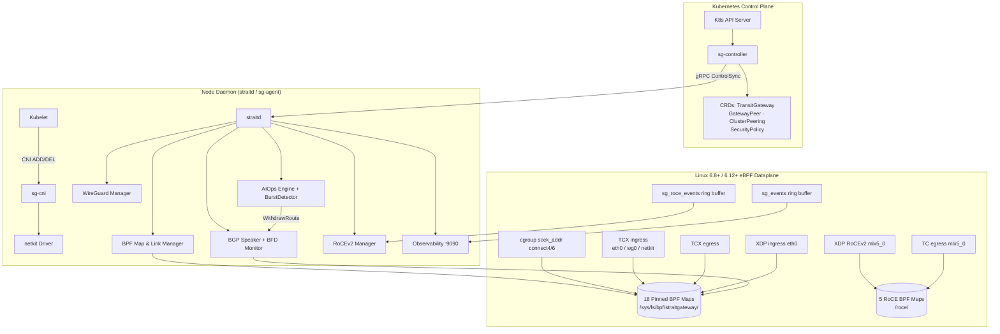

# StraitGateway Documentation

**StraitGateway** is a next-generation Kubernetes transit gateway, native CNI plugin, sidecarless service mesh, and high-performance eBPF dataplane for Linux 6.8+ / 6.12+ LTS kernels. It provides production-grade networking for both conventional microservice workloads and high-throughput AI/ML GPU clusters.

---

## Quick Navigation

| Need | Go to |
|---|---|
| System overview and design | [Architecture Overview](architecture/overview.md) |
| Installing StraitGateway | [Installation Guide](operations/installation.md) |
| Configuring BGP peering | [BGP & BFD Guide](routing/bgp-bfd.md) |
| Kubernetes Gateway API | [Gateway API](gateway-api/gateway-api.md) |
| RoCEv2 / AI-ML networking | [RDMA & RoCEv2](dataplane/rdma-roce.md) |
| Prometheus metrics | [Telemetry](observability/telemetry.md) |
| Debugging failures | [Troubleshooting](operations/troubleshooting.md) |
| CLI reference | [sgctl Reference](operations/sgctl-reference.md) |

---

## Full Documentation Index

### 1. Architecture

| Document | Description |
|---|---|
| [Architecture Overview](architecture/overview.md) | Four-plane system topology, eBPF hook subsystem, core design principles |
| [Multi-Plane Architecture](architecture/multi-plane.md) | Deep dive into Control / Agent / Data / Observability planes, startup sequences, failure isolation model, scalability limits |
| [Kernel Compatibility](architecture/kernel-compatibility.md) | Linux 6.8+/6.12+ LTS prerequisites, CO-RE BTF relocations, sysctl tunings |

### 2. Dataplane Foundation

| Document | Description |
|---|---|
| [eBPF Map Architecture](dataplane/ebpf-maps.md) | All 18 pinned BPF maps: schemas, capacities, eviction policies |
| [Packet Processing Lifecycle](dataplane/packet-processing.md) | XDP DDoS filter → TCX ingress classifier → in-socket L4 LB → conntrack → egress SNAT |
| [RDMA & RoCEv2 Dataplane](dataplane/rdma-roce.md) | BTH/AETH header parsing, XDP + TC programs, DCQCN rate controller, NCCL topology routing, PFC/ECN configuration |

### 3. CNI & IPAM Subsystem

| Document | Description |
|---|---|
| [Netkit L3/L2 Driver](cni/netkit-driver.md) | Direct pod-to-kernel networking, netkit device creation, namespace plumbing |
| [Lockless Bitmap IPAM](cni/ipam.md) | Atomic bitmap allocator, dual-stack support, GC for orphaned IPs, persistence |

### 4. Dynamic Transit Routing

| Document | Description |
|---|---|
| [Transit Gateway](routing/transit-gateway.md) | Multi-VRF LPM routing trie, prefix precedence model, cross-cluster fabric |
| [BGP & BFD](routing/bgp-bfd.md) | RFC 4271 BGP-4 peering, route distribution, sub-50ms RFC 5880 BFD failover |
| [WireGuard Overlay Mesh](routing/wireguard.md) | Point-to-multipoint kernel WireGuard, site-to-site and cluster-to-cluster topologies |

### 5. Service Mesh & Gateway API

| Document | Description |
|---|---|
| [Sidecarless Service Mesh](service-mesh/sidecarless-mesh.md) | Shared NodeProxy, socket redirection via `bpf_msg_redirect_hash`, zero copy overhead |
| [Zero-Trust Security Policies](service-mesh/security-policy.md) | 32-bit identity tokens, default-deny ACLs, L7 HTTP inspection hooks |
| [In-Kernel mTLS](service-mesh/in-kernel-mtls.md) | SPIFFE/SPIRE SVID attestation, kTLS + eBPF `sockops` splicing |
| [Gateway API v1.6.1](gateway-api/gateway-api.md) | HTTPRoute, canary splits, header mutation, gRPC routing, conformance status |

### 6. AI/ML & RDMA

| Document | Description |
|---|---|
| [RDMA & RoCEv2 Dataplane](dataplane/rdma-roce.md) | Full RoCEv2 eBPF stack: BTH parsing, PFC/ECN, DCQCN, NCCL topology |

### 7. Observability & AIOps

| Document | Description |
|---|---|
| [Telemetry & Flow Monitoring](observability/telemetry.md) | Prometheus metrics dictionary, flow ring buffer, JSON flow log API |
| [Autonomous AIOps](observability/aiops.md) | Micro-burst detection (dual EWMA), autonomous BGP withdrawal, W3C Trace Context propagation |

### 8. Operations

| Document | Description |
|---|---|
| [Installation & Deployment](operations/installation.md) | Helm chart, standalone manifest, node prerequisites, upgrade path |
| [sgctl CLI Reference](operations/sgctl-reference.md) | All 13+ command groups: routes, peers, flows, bpf, roce, aiops, trace |
| [Troubleshooting & Diagnostics](operations/troubleshooting.md) | Verifier failure remediation, map dumping, tracepoints, common playbooks |
| [Chaos & Conformance Testing](operations/chaos-conformance.md) | CNI/Gateway API conformance suites, eBPF chaos fault injection, multi-kernel verifier fuzzing |

---

## System Architecture Diagram

---

## Feature Matrix by Phase

| Phase | Feature | Status |
|---|---|---|
| 1 | eBPF CO-RE dataplane foundation (13 pinned maps) | ✅ Complete |
| 2 | Native CNI + lockless bitmap IPAM | ✅ Complete |
| 3 | L4 Service load balancing (Maglev) | ✅ Complete |
| 4 | Conntrack + NAT engine | ✅ Complete |
| 5 | BGP-4 + BFD sub-50ms failover | ✅ Complete |
| 6 | WireGuard multi-cluster overlay mesh | ✅ Complete |
| 7 | Sidecarless service mesh + identity | ✅ Complete |
| 8 | XDP DDoS / micro-segmentation | ✅ Complete |
| 9 | Multi-cluster transit + ClusterMesh | ✅ Complete |
| 10 | Gateway API v1.6.1 + SmartNIC offload | ✅ Complete |
| 11 | SPIFFE/SPIRE + in-kernel mTLS | ✅ Complete |
| 12 | Chaos engineering + conformance CI | ✅ Complete |
| 13 | RoCEv2 / RDMA + DCQCN + NCCL routing | ✅ Complete |
| 14 | Autonomous AIOps + W3C Trace Context | ✅ Complete |
| 15 | Documentation system (this doc) | ✅ Complete |

---

## Getting Help

- **GitHub Issues**: File bugs and feature requests
- **sgctl diagnostics**: `sgctl diagnose --all` for a full system health report
- **Troubleshooting guide**: [operations/troubleshooting.md](operations/troubleshooting.md)
- **Slack**: `#straitgateway` channel
