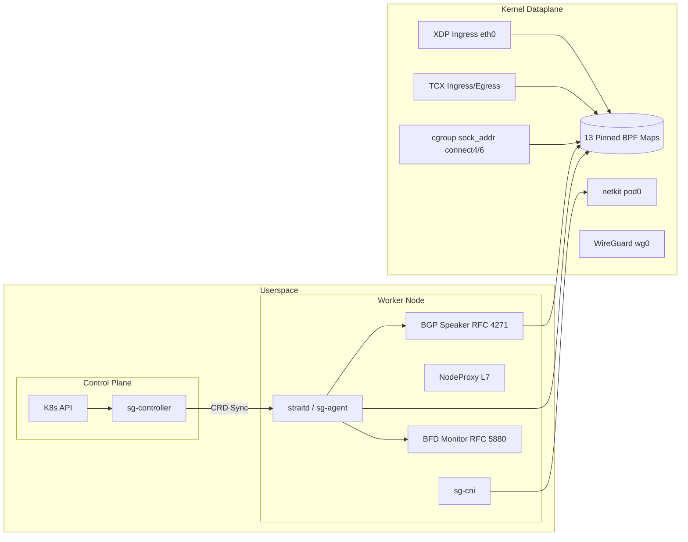

# Architecture Overview

StraitGateway is an enterprise-grade transit gateway, native Container Network Interface (CNI), sidecarless service mesh, and packet processing engine for Kubernetes. It is built specifically to leverage modern Linux kernel capabilities—such as eBPF CO-RE (Compile Once – Run Everywhere), TCX (Traffic Control Express), netkit devices, and socket-layer translation.

---

## 1. Core Design Principles

1. **Decoupled Planes**:
   * **Control Plane (`sg-controller`)**: Watches Kubernetes Gateway API and custom resources (`TransitGateway`, `GatewayPeer`, `ClusterPeering`, `SecurityPolicy`), performing reconciliation and cluster-wide state convergence.
   * **Node Agent Plane (`straitd` / `sg-agent`)**: Runs on each Kubernetes node as a privileged daemon. Manages BPF map pinning, BPF attachment lifecycle, dynamic routing engines (BGP, BFD), WireGuard mesh interfaces, and node observability servers.
   * **Kernel Dataplane**: 100% in-kernel packet processing. No userspace context switching on the L4 fast path.

2. **In-Socket Load Balancing**:
   * Translates Kubernetes Service VIPs directly during `connect()` and `sendmsg()` system calls inside cgroups.
   * Bypasses the network stack entirely for socket endpoints on the same node, eliminating packet overhead.

3. **Direct Container Plumbing via `netkit`**:
   * Uses Linux 6.8+ `netkit` devices instead of legacy `veth` pairs or Linux bridges.
   * Delivers zero-copy skb transmission directly into host networking.

4. **Multi-Cluster Transit Fabric (ClusterMesh)**:
   * Connects Kubernetes clusters across clouds and on-premises sites via automated point-to-multipoint WireGuard overlay networks.
   * Intercepts `*.global.straitgateway` DNS queries for seamless cross-cluster service access.

---

## 2. Component Architecture

---

## 3. Subsystem Breakdown

### 3.1. Dataplane Foundation
* **eBPF CO-RE Programs**: 13 compiled BPF objects handling XDP DDoS mitigation, TCX ingress/egress filtering, service load balancing, conntrack tracking, identity verification, and telemetry ring buffering.
* **Pinned Maps**: Persisted in `/sys/fs/bpf/straitgateway/` to retain datapath state during daemon restarts without packet drops.

### 3.2. CNI Subsystem (`sg-cni`)
* Compliant with CNI Specifications `v0.4.0` and `v1.0.0`.
* Plugs container network namespaces using `netkit` L3/L2 devices.
* Allocates container IPs using a lockless atomic bitmap IPAM allocator.

### 3.3. Transit Routing Subsystem
* Embedded RFC 4271 BGP-4 speaker for Top-of-Rack (ToR) and transit provider peering.
* RFC 5880 Bidirectional Forwarding Detection (BFD) operating at 50ms intervals.
* Linux kernel WireGuard mesh (`wg0`) for encrypted site-to-site and cluster-to-cluster transit.

### 3.4. Sidecarless Mesh Subsystem
* 32-bit cryptographic workload identity derivation based on namespace, ServiceAccount, and labels.
* Zero-trust default-deny security enforcement via eBPF LPM and hash maps (`sg_policies`).
* Shared node-level L7 proxy (`NodeProxy`) spliced directly into TCP streams using `bpf_msg_redirect_hash`.
