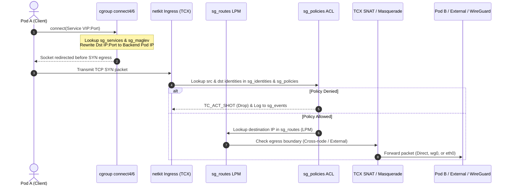

# Packet Processing Lifecycle

StraitGateway processes packets using a multi-tiered eBPF pipeline spanning socket layer hooks, TCX (Traffic Control Express), and XDP (eXpress Data Path).

---

## 1. End-to-End Packet Path Diagram

---

## 2. Processing Stages

### 2.1. Stage 0: Socket-Level Translation (cgroup `connect4` / `connect6`)
* Intercepts `connect()` syscalls originated by containers.
* Checks if `dst_ip` matches a Kubernetes Service ClusterIP in `sg_services`.
* If matched, selects backend using Maglev 65,537 hash table.
* Directly updates `ctx->user_ip4` and `ctx->user_port`.
* **Benefit**: Zero TC/IPVS packet traversal overhead; packets leave the socket already addressed to the target backend pod.

### 2.2. Stage 1: XDP Ingress (NIC Layer)
* Attached to physical interfaces (`eth0`) using `XDP_DRV` (native) or `XDP_SKB` (generic).
* Inspects packet headers for DDoS mitigation and early drops.
* Redirects tunneled WireGuard UDP packets directly to the kernel stack.

### 2.3. Stage 2: TCX Ingress (`netkit` / Physical NIC)
* Attached via `bpf_program__attach_tcx` at ingress hook points.
* Extracts 5-tuple: `(src_ip, dst_ip, src_port, dst_port, proto)`.
* Updates connection tracking state in `sg_conntrack`.
* Derives source identity using `sg_identities`.

### 2.4. Stage 3: Zero-Trust Security Enforcement
* Performs hash lookup in `sg_policies` with `(src_identity, dst_identity, dst_port, proto)`.
* **Verdicts**:
  * `ALLOW`: Forward to routing stage.
  * `DENY`: Emit flow drop record into `sg_events` ring buffer and return `TC_ACT_SHOT`.

### 2.5. Stage 4: FIB LPM Forwarding
* Performs Longest Prefix Match against `sg_routes`.
* Precedence resolution order:
  1. Local Pod interface (`netkit`)
  2. Local Node Service
  3. WireGuard Overlay (`wg0`)
  4. Dynamic BGP Route
  5. Default Gateway (`0.0.0.0/0`)

### 2.6. Stage 5: TCX Egress & NAT
* If packet leaves the cluster PodCIDR to an external destination, rewrites `src_ip` to node IP (SNAT/Masquerade).
* Records reverse translation mapping in `sg_nat`.
